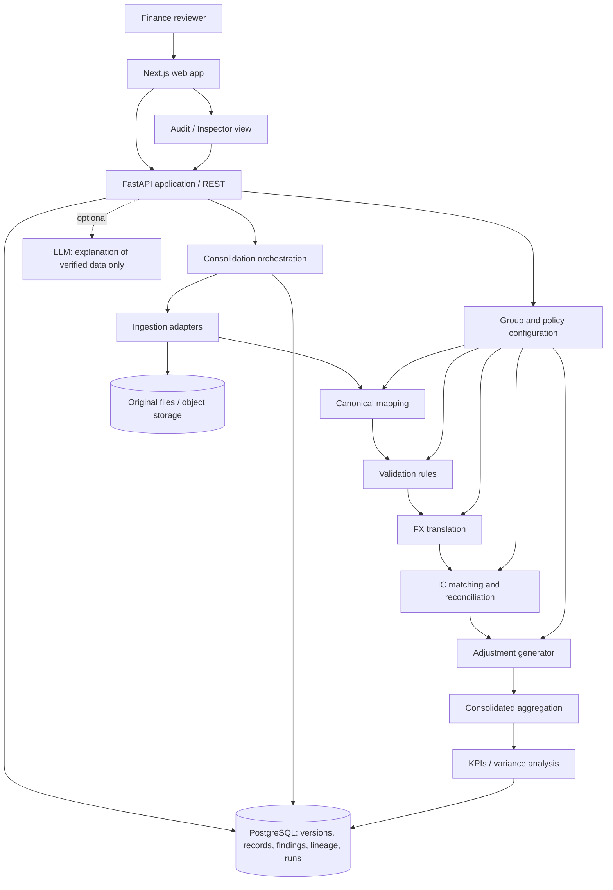
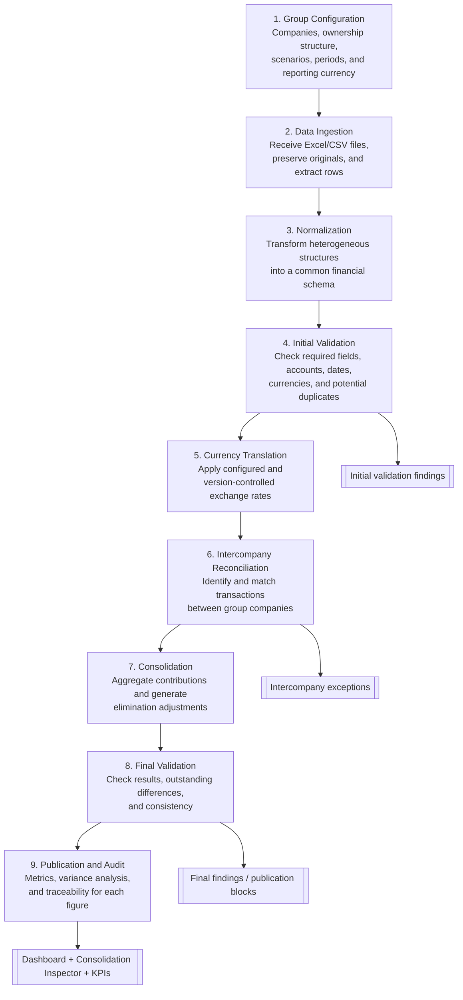
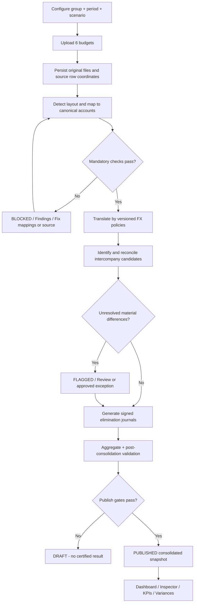
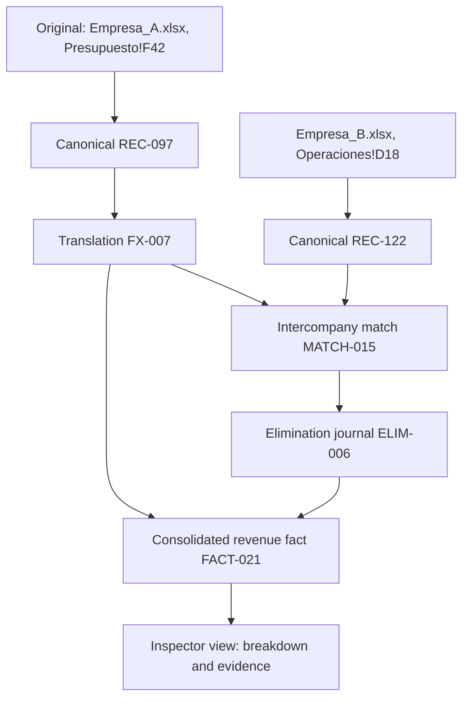

# CONSOLIDA AI — Implementation Plan (`PLAN.md`)

> **Project:** Multi-company budget consolidation, validation, and auditability  
> **Challenge:** Open2 Build & Pitch — Accounting / Grupo AG / *Consolidación multiempresa*  
> **Prepared:** 2026-11-21  
> **Status:** Architecture proposal; implementation depends on inspection of the official dataset  
> **Primary audience:** Hackathon engineering team, technical reviewer, and coding agent  
> **Language:** English; original-language source labels may appear in illustrative sample spreadsheets

---

## 0. Executive decision

**Build a deterministic, auditable budget-consolidation engine, not an Excel chatbot.** The application must ingest six company budgets, normalize inconsistent schemas, validate them, translate currencies, identify and reconcile intercompany transactions or balances, generate auditable elimination adjustments, and publish consolidated budgets with drill-down to the exact originating file/sheet/row.

**Architecture decision:** **modular monolith**. Use **Next.js + TypeScript** for UI, **FastAPI + Python** for the financial engine/API, **PostgreSQL** for configuration and audit data, **openpyxl/Pandas** for spreadsheet import, **Python `Decimal`** plus PostgreSQL `NUMERIC` for financial amounts, and **object/file storage** for unmodified source files. Work synchronously for the hackathon; add background workers later. An LLM is optional and only explains values already computed by the engine.

**North-star demo:** upload six datasets -> detect a real injected error -> inspect the two contributing records -> resolve/approve the issue -> rerun deterministically -> inspect consolidated totals -> drill down from any number to its source.

### What is known versus unknown

| Category | Confirmed by challenge | Pending dataset / organizer verification |
|---|---|---|
| Companies | Six fictional companies | Legal structure, ownership, names, hierarchy |
| Currencies | Three currencies | Codes, exchange-rate table, presentation currency, policy |
| Errors | Deliberately planted errors | Types, expected number, their correct resolution |
| Deliverables | Consolidation; internal-sale eliminations; explanation of variances; ROIC/ROCE/EVA; upload validator; traceable demo | Exact spreadsheet columns, whether there is transactional detail, balance sheet/capital data, forecast versions |
| Data | Fictional group dataset is promised | Whether supplied before or during the event; whether KPIs have sufficient inputs |

**Important limitation:** this plan targets **management/budget consolidation**, not a certified IFRS statutory financial close. IFRS and commercial software are used as design references; never claim statutory compliance without an accountant validating the dataset, accounting policies, ownership, and adjustments.

**Sources:** [R01], [R02], [R03], [R04].

---

## 1. Product requirements and success criteria

### 1.1 MVP (P0, must work end-to-end)

- [ ] Import the six official Excel/CSV budgets and retain originals unchanged.
- [ ] Associate each import with `group_id`, `company_id`, `scenario`, `period`, and `source_version`.
- [ ] Map heterogeneous sheets, columns, account codes, and signs into one canonical record format.
- [ ] Validate all mandatory fields and financial prerequisites; surface actionable findings.
- [ ] Translate supported amounts into the group's configured reporting currency using versioned FX policies.
- [ ] Identify intra-group sales/purchases using trading-partner metadata where available.
- [ ] Reconcile internal pairs (or aggregate bilateral balances if only summary data exists).
- [ ] Generate **separate**, justified elimination adjustments, never overwrite raw values.
- [ ] Calculate consolidated account totals and show source contributions + adjustments.
- [ ] Trace a consolidated number back to the source file, worksheet, row, mapping, rate, match, and rule.
- [ ] Re-run with the same inputs and versions without duplicating any data or adjustments.
- [ ] Demonstrate at least one injected error detected before its impact is published.

### 1.2 Strong additions (P1, if data and time allow)

- [ ] ROIC, ROCE, EVA with explicit definitions, inputs, time periods, and missing-input messaging.
- [ ] Compare original/revised budget or budget/actual and explain differences by company/account/FX/eliminations.
- [ ] Resolve exceptions in the UI with documented approval and a new immutable run.
- [ ] Explain calculations in English using deterministic templates, optionally with AI narration; add localization later if required.
- [ ] Export consolidated budget and audit detail to CSV/XLSX.

### 1.3 Later (P2 / production roadmap)

- [ ] Ownership changes, non-controlling interests, consolidation of investments, acquisitions/disposals.
- [ ] Elimination of unrealized profit in inventory/fixed assets; dividends; intercompany balances and FX intricacies.
- [ ] Multiple consolidation hierarchies, subgroups, consolidated currencies, periods, and legal reporting policies.
- [ ] Team approval workflows, SSO/RBAC, multi-tenancy, background workers, telemetry.
- [ ] Connectors to ERP, S3, SharePoint/Drive; incremental partition-level reprocessing.
- [ ] AI-assisted mapping suggestions with human approval and explainable confidence.

### 1.4 Non-goals for the four-hour build

- A general-purpose ERP/accounting system; certified IFRS statutory reporting.
- Arbitrary spreadsheet formula execution or full Excel macro support.
- Complex ownership-accounting rules not required by the provided files.
- Autonomous LLM accounting decisions or invented FX/tax/WACC assumptions.
- Microservices, Kubernetes, elaborate workflow orchestration, or fully automated reconciliation without supporting evidence.

---

## 2. Financial domain: the rules we must get right

### 2.1 What is actually being consolidated?

**Consolidated group results** represent included companies as a single economic entity, subject to the accounting/reporting basis and scope. For our budget MVP:

1. Select the included companies and the `period` + `scenario` + `reporting_currency`.
2. Normalize comparable company accounts into group accounts.
3. Translate values according to approved rates and policies.
4. Sum contributions and separately generated consolidation adjustments.
5. Eliminate appropriate within-group sales/costs or other allowed items so no double counting survives.
6. Validate reconciliations and publish with a full evidence trail.

**Not every row is an intercompany transaction.** External revenues/expenses remain; only specified intra-group positions have elimination treatment. **An internal operation must be identified by valid group membership and a trading partner, not by an identical amount alone.** [R02], [R03], [R06], [R07].

**If source files contain only summary account balances**, match/flag at **company-pair + period + account** level; do **not** represent summary balances as independently verified transaction matches. If the files contain transaction IDs, invoice IDs, dates, and partners, enable transaction-level matching.

### 2.2 Example: internal sale elimination

Assume A buys goods from an external supplier for Q60,000; A sells the goods to group company B for Q100,000; B sells all the goods to an external customer for Q150,000, with no inventory remaining.

| Metric | Sum of separate businesses | Correct consolidated group |
|---|---:|---:|
| Revenue | Q250,000 | Q150,000 |
| Cost of sales | Q160,000 | Q60,000 |
| Group profit | Q90,000 | Q90,000 |

**Consolidation adjustment:** reduce internal revenue by Q100,000 and internal cost of sales by Q100,000. In accounting-sign terms, a balanced elimination entry debits internal revenue and credits cost of sales; the actual journal generation must honor the selected sign convention and account definitions.

**Caveat:** this example requires that B sold the inventory externally. If inventory remains, elimination of **unrealized intercompany profit** may also be required and is excluded from the MVP unless input data supports it. **An FX gain/loss from an intragroup monetary item may survive a balance elimination** under IAS 21; don't implement blanket cancellation of all FX differences. [R02], [R05].

### 2.3 Different layers of the financial data

Keep separate and identifiable:

1. `SOURCE`: the original received data (never overwrite).
2. `CANONICAL`: parsed, account-mapped, signed, standardized representation.
3. `TRANSLATED`: group-currency contribution, with `fx_rate_id` and precision policy.
4. `MATCH / RECONCILIATION`: relationship between possibly related internal records.
5. `ADJUSTMENT`: journal-like elimination or reviewed correction with references.
6. `CONSOLIDATED`: calculated output for a specific immutable `run_id`.

**Reporting formula:**

`consolidated_amount = SUM(translated_contributions) + SUM(signed_consolidation_adjustments)`

Do not mix normalized local amounts, translated amounts, adjustments, and final totals inside the same mutable field.

### 2.4 Ownership boundaries

- Store entity hierarchy, effective dates, `ownership_pct`, and `consolidation_method` even if the MVP assumes 100% controlled entities.
- Never blindly multiply a controlled subsidiary's revenue by ownership percentage; consolidated financial statements for controlled subsidiaries generally include its revenues/expenses in full with appropriate non-controlling-interest presentation.
- Associates, joint ventures, and investment consolidation require a separate accounting policy and are P2 unless required by the dataset.
- Eliminate only within the **effective consolidation perimeter** and according to the accounting method. [R02], [R06], [R07].

---

## 3. Market research: what established products do

| Platform | Documented pattern | What we should adopt | Source |
|---|---|---|---|
| **SAP S/4HANA Group Reporting** | Collect/release source data, map to group financial items, validate, post manual journals, translate, reconcile IC, then eliminate and report | A staged process with pre/post validation and configurable account mapping | [R03], [R08], [R09] |
| **Oracle Financial Consolidation and Close** | Separate entity-input, translation, proportions, elimination, and data-source/consolidation dimensions; retain audit trails | Explicit adjustment records, calculation stages, and source dimensions | [R06], [R07], [R10] |
| **Microsoft Dynamics 365 Finance** | Account mappings, multiple consolidation/reporting patterns, import, elimination rules, multi-currency budget reporting and drill-down | Configurations per entity/account and support for non-uniform sources | [R11], [R12] |
| **OneStream** | Currency translation, entity hierarchy, intercompany matching/elimination, quality and audit controls | Exception-centric review and extensible, dimension-based design | [R13], [R14] |

**Our differentiation for the hackathon:** make the result understandable and traceable *down to file/sheet/row*, show before/after adjustments, and clearly expose blocked vs flagged inconsistencies. Build a narrower but verifiable experience, not a broad but superficial replica.

---

## 4. Recommended architecture

### 4.1 Architecture diagram



**Architectural style:** modular monolith using clean separation of **domain** (pure financial rules), **application** (pipeline/use cases), **adapters** (Excel, database, HTTP), and **presentation** (frontend). HTTP controllers do not calculate consolidation values.

### 4.2 Technology selection

| Component | MVP | Why / future evolution |
|---|---|---|
| UI | Next.js + TypeScript + Tailwind + shadcn/ui | Fast demo and maintainable forms/tables; no reliance on front-end financial math |
| API | FastAPI + Pydantic | Python ecosystem for Excel and validation; typed request/response contracts |
| Spreadsheet reading | openpyxl (primary) + Pandas (bulk tabular transformations) | Preserve sheet/row/cell coordinates; Pandas helps reshape wide monthly reports |
| Financial arithmetic | `decimal.Decimal` | Exact decimal arithmetic with explicit rounding policy [R18] |
| DB | PostgreSQL + SQLAlchemy + Alembic | Entity mappings, versioned runs, exact `NUMERIC`, relational lineage [R19] |
| Original files | Local filesystem in a Docker volume | S3-compatible object storage with object hashes and access controls later |
| Async processing | In-process for the hackathon | Queue/worker per `run_id` later for long-running imports |
| LLM | **Not required** for core | Narrate validated facts only; never use output as ledger/accounting truth |
| Runtime | Docker Compose: `web`, `api`, `postgres` | Deployment split later; keep deterministic processing in API/workers |

**Fallback for severe time limits:** SQLite may replace PostgreSQL locally **without changing the domain contracts**, but Postgres is the preferred baseline for a product intended to grow. Avoid introducing Redis/Celery during the hackathon unless files are too large for synchronous requests.

### 4.3 Domain module boundaries and ownership

| Module | Owns | Must not own |
|---|---|---|
| `ingestion` | Validate/upload file; inspect sheets; extract cell values and metadata | Classification of accounts |
| `normalization` | Map columns and accounts; normalize signs and periods | Group FX calculation |
| `validation` | Configurable rules; findings/severity; publishing gates | Mutating source records |
| `fx` | Rate selection, conversion, rounding, reporting-currency context | Fetching arbitrary live FX rates for a budget |
| `intercompany` | Candidate discovery, exact/aggregate matching, tolerance, reconciliations | Inventing missing counterpart records |
| `consolidation` | Create balanced signed adjustments; aggregate facts; report snapshots | Overwriting original data |
| `lineage` | Source-to-output relationships; audit and replay evidence | Financial calculations |
| `analytics` | Ratios, variance decomposition, explainable breakdowns | Missing financial assumptions |
| `application` | Orchestrate runs, transaction boundaries, publish status | Hard-coded account rules |

### 4.4 Suggested repository layout

```text
consolida-ai/
├── PLAN.md
├── README.md
├── docker-compose.yml
├── .env.example
├── apps/
│   ├── web/                           # Next.js (TS)
│   │   ├── app/
│   │   │   ├── uploads/
│   │   │   ├── configurations/
│   │   │   ├── runs/[runId]/
│   │   │   ├── findings/
│   │   │   └── inspector/[factId]/
│   │   └── components/
│   └── api/                           # FastAPI (Python)
│       ├── app/
│       │   ├── api/routes/
│       │   ├── application/
│       │   ├── domain/
│       │   │   ├── ingestion/
│       │   │   ├── normalization/
│       │   │   ├── validation/
│       │   │   ├── fx/
│       │   │   ├── intercompany/
│       │   │   ├── consolidation/
│       │   │   ├── lineage/
│       │   │   └── analytics/
│       │   ├── infrastructure/
│       │   │   ├── db/
│       │   │   ├── storage/
│       │   │   └── excel/
│       │   └── main.py
│       ├── alembic/
│       └── tests/
│           ├── fixtures/
│           ├── unit/
│           ├── integration/
│           └── e2e/
└── docs/                                 # Can split sections from PLAN.md later
    ├── DATA_DICTIONARY.md
    ├── FINANCIAL_RULES.md
    ├── API_CONTRACT.md
    └── DEMO_SCRIPT.md
```

**Do not create all folders just for appearances:** implement the vertical slice first. The `docs/` files above are intended future extractions; **this PLAN.md contains the initial specification**.

---

## 5. End-to-end pipeline and publishing gates

### 5.0 Consolidation Pipeline (high-level flow)

Each stage produces verifiable outputs that feed the next. The objective is not merely to process files, but to retain enough evidence to recalculate, audit, and explain every consolidated figure.



### 5.0.1 Stage deliverables

| Stage | Primary output artifact |
|---|---|
| Group Configuration | Versioned consolidation perimeter, scenarios, and policies |
| Data Ingestion | Original files, metadata, and extracted source rows |
| Normalization | Canonical records by company, account, and period |
| Initial Validation | Data-quality findings and blocked or approved records |
| Currency Translation | Translated contributions linked to the applied exchange rate |
| Intercompany Reconciliation | Matches, candidates, differences, and exceptions |
| Consolidation | Elimination adjustments and preliminary consolidated balances |
| Final Validation | Snapshot ready for review or blocked from publication |
| Publication and Audit | Published results, KPIs, variances, and searchable lineage |



**Policy:** no silent dropping, repairing, auto-elimination, or posting of uncertain records. A flagged run may produce a **draft diagnostic preview**, but the UI must clearly distinguish preview totals from a publishable result. If the rules require review, approval is recorded and attached to that versioned run.

### 5.1 Operational statuses

- **Import batch:** `UPLOADED`, `PARSING`, `PARSED`, `REJECTED`.
- **Record processing:** stages `IMPORTED`, `NORMALIZED`, `VALIDATED`, `TRANSLATED`, `INCLUDED`; validation findings are **orthogonal** to stages.
- **Reconciliation:** `NOT_APPLICABLE`, `UNMATCHED`, `MATCH_CANDIDATE`, `MATCHED`, `DISPUTED`, `APPROVED_EXCEPTION`.
- **Run:** `CREATED`, `RUNNING`, `DRAFT`, `BLOCKED`, `READY_FOR_REVIEW`, `PUBLISHED`, `FAILED`.
- **Finding:** `OPEN`, `UNDER_REVIEW`, `RESOLVED`, `ACCEPTED_RISK`, `SUPERSEDED`.

**Why separate states?** An external sale can be consolidated without `MATCHED`, while an internal match can have a separate warning. Do not enforce an incorrect universal sequence on all rows.

### 5.2 Pipeline gates

| Gate | Requirement | On failure |
|---|---|---|
| Import | Files parse, size/format safe, sheets and sources identified | Reject import or affected file |
| Canonical | Company, account, period, amount, sign, currency mapped | Block affected records/run |
| FX | Correct versioned rate exists for each required contribution | Block affected results |
| IC | Supported pairs are matched or valid documented exceptions exist | Flag; block publication per group policy |
| Adjustments | Entry is balanced, sourced, supported, within permissible policy | Block publication |
| Final | Totals reconcile, all blocking findings resolved, immutable run fingerprint retained | Keep draft; no published status |

---

## 6. Spreadsheet ingestion and mapping contracts

### 6.1 Keep raw and canonical data separate

**Original upload:** store binary unchanged, SHA-256 digest, original filename, uploader/time, company, scenario, period, byte size, parsing adapter/version, and permission metadata.

**Source row:** store sheet name, physical row number, relevant cell coordinates, raw values and types, formulas and cached results where relevant. A `source_row_id` is permanent within one source-file version.

**Canonical row:** each row represents a single company + account + period + scenario + currency + optional counterpart + amount + source, and may be generated from an original wide spreadsheet row with 12 month columns. Its lineage must include the **source cell coordinates** (e.g. `Presupuesto!F42`, not only row 42).

### 6.2 Structural mapping example

```json
{
  "mapping_version": "MAP-V1",
  "company_id": "GT_001",
  "sheet": "Presupuesto",
  "header_row": 3,
  "account_code_column": "Cuenta",
  "description_column": "Descripción",
  "amount_columns": {
    "Enero": "2027-01",
    "Febrero": "2027-02"
  },
  "defaults": {"currency": "GTQ", "scenario": "BUDGET"},
  "counterparty_column": "Empresa vinculada",
  "numeric_locale": "es_GT"
}
```

### 6.3 Account mapping example

```json
{
  "mapping_version": "COA-2027-V1",
  "company_id": "GT_001",
  "source_account_code": "4001",
  "group_account_code": "REVENUE_EXTERNAL",
  "account_type": "REVENUE",
  "normal_balance": "CREDIT",
  "sign_multiplier": 1,
  "fx_policy": "P_AND_L_AVERAGE",
  "effective_from": "2027-01"
}
```

**Account naming conventions are proposal-specific**, not official dataset values. Final mappings must be confirmed after reading the Excel sheets.

### 6.4 Parser requirements

- `PARSER-001` Sheet selection and header detection; manual override if ambiguous.
- `PARSER-002` Locale-safe parsing of decimals, thousand separators, negative parentheses, date formats.
- `PARSER-003` Wide-to-long reshape: one amount per month; source cell pointer remains attached.
- `PARSER-004` Formula handling: capture formula text and stored/cached output separately; **openpyxl does not evaluate formulas**. Missing cached results must be flagged rather than fabricated. [R16].
- `PARSER-005` Do not assume blank = zero unless a policy explicitly says so.
- `PARSER-006` No silent loss of unknown columns or unmapped account codes.
- `PARSER-007` Detect exact duplicate file hashes and duplicate canonical logical keys as distinct issues.
- `PARSER-008` Validate supported file extensions, MIME/signature, decompressed size, row counts, and XLSX ZIP-archive safety. [R20].
- `PARSER-009` Never run VBA macros or spreadsheet formulas from untrusted files.
- `PARSER-010` Report parse errors with company/file/sheet/row/column and corrective action.

### 6.5 Canonical financial record

```json
{
  "record_id": "REC_000097",
  "group_id": "GRUPO_AG",
  "company_id": "GT_001",
  "scenario": "BUDGET",
  "period": "2027-01",
  "group_account_id": "REVENUE_INTERCOMPANY",
  "account_type": "REVENUE",
  "amount_local": "100000.00",
  "currency_local": "GTQ",
  "trading_partner_company_id": "GT_002",
  "source_transaction_ref": "IC-0001",
  "source_row_id": "SRC_000042",
  "source_cell": "Presupuesto!F42",
  "account_mapping_version": "COA-2027-V1",
  "classification": "INTERCOMPANY_CANDIDATE"
}
```

Amounts in JSON are **strings** so they are parsed as `Decimal`, never JavaScript or Python floating-point values for financial computation.

---

## 7. Versioned currency conversion

### 7.1 Model

Use **ISO currency codes** and rows keyed by:

`(fx_rate_set_id, from_currency, to_currency, period/date, rate_type)`

Example (entirely fictitious, not a live market rate):

| From | To | Period | Rate type | Illustrative multiplier |
|---|---|---|---|---:|
| GTQ | USD | 2027-01 | `AVERAGE` | 0.130000 |
| MXN | USD | 2027-01 | `AVERAGE` | 0.050000 |
| GTQ | USD | 2027-01 | `CLOSING` | 0.128000 |

`converted_amount = amount_local * multiplier` where **multiplier is units of destination currency per 1 unit of source currency**. Store direction to prevent accidental reciprocal-rate errors.

### 7.2 Policies

- For **income/expenses**, financial-statement translation ordinarily uses transaction-date rates, with a representative average where appropriate; the plan budget may use **approved budget rates by period**. [R05].
- For **assets/liabilities** in a foreign operation statement, closing rates ordinarily apply (subject to applicable accounting circumstances). [R05].
- Historical-rate/FX-reserve treatment is **not** a single universal rule for every equity item; design policy flags and keep statutory FX treatment out of MVP unless the files justify it.
- Missing rates and unknown quote direction are **blocking findings**, not reasons to use live currency quotes.
- Store rate **source**, **version**, **effective period/date**, **rate type**, **precision**, and **policy ID**. A `run` pins one rate-set version.
- Use sufficient internal Decimal precision; round **at the documented posting/reporting boundary**, not at every intermediate calculation. Track rounding adjustments separately when needed.
- One currency in one group should never create hard-coded `if GTQ... elif MXN...` branches.

### 7.3 FX invariant

For every translated record:

`amount_group = quantize(amount_local * fx_rate, group_precision)`

Its lineage includes `record_id`, `fx_rate_id`, `fx_policy_id`, `run_id`, `rounding_policy`.

For a scenario comparison, calculate the **operational** variance at constant FX rates and the **FX-driven** variance under a documented decomposition method; reconcile the components exactly to the total. No unsupported attribution.

---

## 8. Intercompany identification, matching, and eliminations

### 8.1 Eligibility

A record may be a candidate for elimination only when:

1. It belongs to a company **inside the active group perimeter** for that period.
2. Its `trading_partner_company_id` is a valid group company in the same perimeter.
3. Its account/record type is eligible under a versioned **intercompany elimination policy**.
4. It concerns a compatible period/scenario, and has sufficient supporting detail for transaction-level or aggregate reconciliation.
5. The adjustment is valid for the selected reporting basis and grouping (e.g. elimination at the common parent when multi-level hierarchies exist).

**Do not eliminate every internal-looking line by description**. Oracle explicitly conditions automatic IC elimination on eligible accounts and valid partner metadata within the consolidation hierarchy. [R07].

### 8.2 Matching tiers

| Tier | Candidate evidence | Action |
|---|---|---|
| Exact transaction | Reciprocal A->B / B->A parties, shared invoice/reference, compatible period/account, amounts in common transaction currency agree | May auto-match if uniqueness proven |
| Composite transaction | Reciprocal partner, compatible accounts, close dates, same or convertible amounts within a policy tolerance | Suggest / require review |
| Aggregate | Source supports partner balances or intercompany revenue/purchase totals per company pair/account/period | Match totals **as aggregate**, not individual transactions |
| Insufficient | Missing counterpart, non-unique rows, incompatible periods, missing rate/reference | `DISPUTED`/`UNMATCHED` finding |

Use **unique pair allocation**; a source record cannot be auto-matched to multiple unrelated records. Keep `match_group_id`, all record IDs, decision rule/version, amounts by currency, discrepancy, tolerance, evidence, reviewer.

### 8.3 Difference handling

If A reports Q100,000 of IC revenue and B reports Q98,000 of the corresponding IC purchase:

- Raise `IC_AMOUNT_MISMATCH` with a discrepancy of Q2,000 in the reconciled currency.
- Inspect timing, date, rounding, withholding, FX, recognition, and missing postings.
- **Never** silently choose one amount or delete the discrepancy.
- If finance approves a correction, create a separate versioned adjustment with documented reason and reviewer.
- A policy may let an approved immaterial discrepancy remain and still publish as `APPROVED_EXCEPTION`; make that explicit in the report.

### 8.4 Consolidation entries and signs

Create elimination records as **journal headers and lines**, even if the external budget files have no double-entry information. Example for the fully externally resold inventory case in §2.2:

| Journal | Account | Debit | Credit |
|---|---|---:|---:|
| `ELIM-001` | Intercompany sales / revenue | Q100,000 | — |
| `ELIM-001` | Cost of goods sold | — | Q100,000 |

- Enforce balanced debit/credit in adjustment journal currency **before publication**.
- Record `journal_id`, `run_id`, `rule_id` and `rule_version`, company pair, source record IDs, amount, currency, reviewer/approval, and optional parent entity.
- Translate or create the journal at the right stage, preserving source and FX rate context.
- **Do not double-eliminate**: elimination engine generates one logical journal for one resolved match/aggregate scope per run.
- Apply appropriate policies for separate **balance-sheet receivable/payable** eliminations when supported by the dataset; the P&L example alone does not prove all intragroup transactions are treated correctly.

### 8.5 General cases *not* silently assumed in MVP

- Unfulfilled inventory sales and elimination of unrealized profits.
- Intercompany loans/interest/cash flows, and FX differences on monetary balances.
- Dividends, non-controlling interests, acquisition/consolidation of investments.
- Partial/multi-way matches, timing accruals, tax effects, different fiscal calendars.

These require additional accounting rules and input information. [R02], [R05], [R07], [R14].

---

## 9. Validation rule catalog and exception lifecycle

### 9.1 Severity

- **BLOCKER:** invalid prerequisite prevents publication of the impacted results.
- **WARNING:** reasonable result may still be usable with documented review or approval.
- **INFO:** anomaly, contextual issue, or analytic observation that does not prove error.

Severity and publishing scope are **policy-configurable** by group, rule, scenario, and account class.

| Rule ID | Trigger | Default severity | Suggested response |
|---|---|---|---|
| `VAL-001` | Unknown/inactive company | BLOCKER | Register/fix company |
| `VAL-002` | Invalid/missing required monetary value | BLOCKER | Correct source or explicit null policy |
| `VAL-003` | Missing/ambiguous group-account mapping | BLOCKER | Approve mapping |
| `VAL-004` | Unknown currency or required FX rate absent | BLOCKER | Configure rate set |
| `VAL-005` | Invalid period or scenario | BLOCKER | Correct source context |
| `VAL-006` | Potential duplicate record | WARNING | Review key/hash; detect exact vs semantic duplicates |
| `VAL-007` | Missing IC trading partner where required | WARNING / BLOCKER | Provide partner or approved exception |
| `VAL-008` | IC amount discrepancy above tolerance | WARNING / BLOCKER | Reconcile / approve treatment |
| `VAL-009` | Large variance versus prior/revised budget | INFO | Investigate but don't label as error |
| `VAL-010` | Source total does not equal parsed detail | BLOCKER | Inspect file formulas/ranges/overlap |
| `VAL-011` | Wrong rate type / period / direction | WARNING / BLOCKER | Use approved FX policy |
| `VAL-012` | Duplicate adjustment or duplicated entity scope | BLOCKER | Ensure idempotency |
| `VAL-013` | Invalid or unbalanced elimination journal | BLOCKER | Fix generation policy |
| `VAL-014` | Missing capital/tax/WACC for KPI | INFO / KPI_BLOCKED | Withhold KPI, not unrelated budget output |
| `VAL-015` | Source formula without usable cached value | WARNING / BLOCKER | Require source to recalculate/export values |
| `VAL-016` | Unknown sign convention | BLOCKER | Approve source-account polarity rule |
| `VAL-017` | Unsupported ownership/consolidation method | BLOCKER for affected scope | Explicit out-of-scope handling |
| `VAL-018` | Broken source provenance / missing row reference | BLOCKER | Repair ingestion metadata |

**A double-entry balance check is only applicable if the source contains a valid trial balance or journal.** Do not assume every budget spreadsheet must have debits and credits.

### 9.2 Finding record

```json
{
  "finding_id": "FIND-021",
  "run_id": "RUN-003",
  "rule_id": "VAL-008",
  "rule_version": "1.2.0",
  "severity": "WARNING",
  "status": "OPEN",
  "affected_record_ids": ["REC-097", "REC-122"],
  "expected_amount": "100000.00",
  "observed_amount": "98000.00",
  "discrepancy": "2000.00",
  "currency": "GTQ",
  "reason_code": "INTERCOMPANY_AMOUNT_MISMATCH"
}
```

### 9.3 Resolution history

Every resolution logs `actor`, `timestamp`, `action`, `reason_code`, `notes`, `source_evidence_ids`, `approval_status`, `before/after rule or record`, and `resulting_run_id`. Do not mutate an old published snapshot. A correction produces a new source version or approved adjustment and then a **new run**.

---

## 10. Data model and audit lineage

### 10.1 Minimum normalized schema

| Table | Representative fields | Purpose |
|---|---|---|
| `groups` | `id`, `name`, `reporting_currency` | Customer/group configuration |
| `companies` | `id`, `group_id`, `parent_id`, `functional_currency`, `effective_dates`, `consolidation_method`, `ownership_pct` | Entity hierarchy and scope |
| `scenarios` | `id`, `name`, `fiscal_year`, `version` | Budget/forecast/actual version |
| `source_files` | `id`, `sha256`, `company_id`, `scenario_id`, `stored_uri`, `source_version`, `uploaded_at` | Immutable originals |
| `source_rows` | `id`, `source_file_id`, `sheet`, `row_index`, `raw_json`, `cell_refs_json` | Physical source evidence |
| `canonical_records` | `id`, `source_row_id`, `company_id`, `account_id`, `period`, `amount_local NUMERIC`, `currency`, `partner_id`, `mapping_version` | Normalized individual records |
| `group_accounts` | `id`, `type`, `statement`, `normal_balance`, `fx_policy` | Common chart of accounts |
| `account_mappings` | `company_id`, `local_code`, `group_account_id`, `sign`, `version`, `effective_dates` | Configurable COA mapping |
| `fx_rate_sets` | `id`, `scenario_id`, `version`, `approved_by` | Versioned FX assumptions |
| `fx_rates` | `id`, `rate_set_id`, `from`, `to`, `period`, `rate_type`, `rate NUMERIC`, `source` | FX policies and factors |
| `consolidation_runs` | `id`, `group_id`, `scenario`, `period`, `config_fingerprint`, `code_version`, `status`, `created_at` | Immutable execution identity |
| `run_sources` | `run_id`, `source_file_id` | Exact versioned input set |
| `translated_records` | `run_id`, `canonical_record_id`, `fx_rate_id`, `amount_group NUMERIC` | Currency results |
| `match_groups` | `id`, `run_id`, `match_mode`, `status`, `difference`, `rule_version` | Pair/aggregate reconciliation |
| `match_members` | `match_group_id`, `canonical_record_id`, `side` | Match participants |
| `adjustment_journals` | `id`, `run_id`, `rule_id`, `status`, `currency`, `reason`, `approval` | Head of each adjustment |
| `adjustment_lines` | `id`, `journal_id`, `group_account_id`, `debit NUMERIC`, `credit NUMERIC`, `entity_id` | Signed/accounting entries |
| `journal_sources` | `journal_id`, `source_record_id` | Evidence linking eliminations to sources |
| `validation_findings` | `id`, `run_id`, `rule_id`, `severity`, `status`, `amount`, `context_json` | Exceptions |
| `finding_events` | `finding_id`, `actor`, `event_type`, `timestamp`, `comment`, `related_run_id` | Decision audit trail |
| `consolidated_facts` | `id`, `run_id`, `account_id`, `period`, `amount_group NUMERIC`, `scope_id` | Published or draft report cells |
| `lineage_edges` | `parent_ref`, `child_ref`, `run_id`, `transformation`, `rule_id`, `version` | Generic source-to-result graph |

All `group_id`-scoped tables must be filtered or tenant-isolated in production. Put unique constraints on `run_id + source_record_id` for translated contributions and on the journal's logical elimination identity to prevent duplicate application.

### 10.2 Source -> result traceability



Each edge describes `parent`, `child`, `transformation`, `rule_id`, `run_id`, `version`. Exact naming of parent/child direction must be documented consistently (recommend **child=derived output, parent=input ancestor**).

For very large aggregations, avoid recursively materializing a separate graph edge for every intermediate cell if a relational join can reconstruct lineage. Link **translated contribution rows and journal lines** to the run and group account, and query them using indexed fields; include explicit `lineage_edges` for nontrivial mappings, matches, and transformations.

### 10.3 Consolidation inspector contract

Clicking any number should reveal:

1. Result identifier, amount, period, scenario, reporting currency and run/version.
2. Raw company-level contributions before elimination.
3. FX conversion detail and underlying rate/policy.
4. Every adjustment journal and IC match that affected it.
5. Findings/approvals and whether the result is draft or published.
6. File name, sheet, exact source row **and cell**, original raw amount and account.

No unverifiable summary sentence should appear as if it were a proven calculation.

### 10.4 Reproducibility contract

A run stores a fingerprint of **ordered source file digests, mapping versions, FX rate-set version, rule-set version, group hierarchy version, target period/scenario, rounding policy, and code version**. Re-running with identical versions must yield an identical normalized/reporting result within the documented deterministic rounding rules.

A new upload or rule revision creates a new run; old published results are not overwritten.

---

## 11. KPI calculations and financial completeness

Compute these **only if validated inputs exist**. Keep the metric definition and time basis in metadata because firms differ in definitions.

| KPI | Proposed definition | Minimum prerequisite data |
|---|---|---|
| **ROIC** | `NOPAT / average invested capital` | EBIT/NOPAT, tax policy, capital at beginning/end or approved averaging basis |
| **ROCE** | `EBIT / capital employed` | EBIT, capital employed definition (e.g. assets minus current liabilities), consistent period basis |
| **EVA** | `NOPAT - (WACC * invested capital)` | NOPAT, WACC, capital basis and period convention |

**Do not substitute arbitrary values** for taxes, WACC, invested capital, or capital employed. If the six budgets only contain P&L totals, label these KPIs `INSUFFICIENT_DATA` and list exact missing inputs. [R15], [R21], [R22].

**Calculation semantics:**

- `NOPAT` generally reflects operating profit after tax; methodology must specify tax treatment.
- ROIC denominator is usually an average over the measurement period; avoid casually substituting an end-of-period snapshot.
- `EVA` is an economic-profit metric and may have source-specific adjustments; no claim of exact corporate-grade EVA without defining adjustments.
- The KPI view should expose formula, numerator, denominator, tax/rate assumptions, data versions, and source records.

---

## 12. Variance engine and explanations

### 12.1 Comparison keys

Compare aligned periods and report scopes, e.g. `BUDGET_ORIGINAL` vs `BUDGET_REVISED` or `BUDGET` vs `ACTUAL`, using the **same group chart and explicit currency policy**.

`net_variance = revised_consolidated - baseline_consolidated`

When supporting inputs exist, decompose into:

- **Operational/account change:** source entity budgets changed at constant approved FX.
- **FX effect:** retranslate consistent underlying amounts under changed FX policy.
- **Intercompany elimination change:** matches/eligible internal amounts changed.
- **Mapping or reclassification:** account classifications changed between versions.
- **Perimeter change:** group entities included/excluded (P2 unless needed).

A waterfall must reconcile all components: `SUM(component_variances) == net_variance` under documented rounding.

### 12.2 Explanation contract

- Deterministic explanations should be the default: templates mention actual account, company, rates, before/after amounts and evidence IDs.
- Optional LLM receives **read-only verified structured facts**, including calculated components and source references; it cannot alter arithmetic, create an adjustment, or invent a cause.
- If the model cannot support a causal explanation, report an observation (e.g. "revenue fell in entity B") rather than claiming to know the business reason.

---

## 13. Suggested REST API

All mutation endpoints should validate versioned input references. `run_id` determines the entire reporting snapshot.

| Verb | Endpoint | Responsibility |
|---|---|---|
| `POST` | `/api/v1/files` | Upload / identify original files |
| `GET` | `/api/v1/files/{file_id}/preview` | Sheets, columns, rows, parse warnings |
| `POST` | `/api/v1/mappings` | Create draft mapping version |
| `POST` | `/api/v1/mappings/{id}/approve` | Freeze mapping version for use |
| `GET` | `/api/v1/groups/{id}/companies` | Entity scope and currencies |
| `POST` | `/api/v1/fx-rate-sets` | Create/pin forecast FX assumptions |
| `POST` | `/api/v1/consolidations` | Start a `run` with explicit source/mapping/rates/rules |
| `GET` | `/api/v1/consolidations/{run_id}` | Status, stages, counts, blocking findings |
| `GET` | `/api/v1/consolidations/{run_id}/facts` | Consolidated facts / dimensions |
| `GET` | `/api/v1/consolidations/{run_id}/reconciliations` | IC matches, missing counterparts |
| `GET` | `/api/v1/consolidations/{run_id}/findings` | Filterable rule findings |
| `POST` | `/api/v1/findings/{finding_id}/decisions` | Record resolution/approval (new run if input changes) |
| `GET` | `/api/v1/facts/{fact_id}/lineage` | Exact contributions, adjustments and source cells |
| `GET` | `/api/v1/consolidations/{run_id}/kpis` | Metrics with completeness status |
| `GET` | `/api/v1/variances?baseline=...&revised=...` | Decomposed variance |
| `POST` | `/api/v1/consolidations/{run_id}/publish` | Review and freeze approved snapshot |

### 13.1 Example consolidation command

```json
{
  "group_id": "GRUPO_AG",
  "scenario_id": "BUDGET_2027",
  "periods": ["2027-01", "2027-02"],
  "reporting_currency": "USD",
  "source_file_ids": ["SRCFILE-1", "SRCFILE-2", "SRCFILE-3", "SRCFILE-4", "SRCFILE-5", "SRCFILE-6"],
  "mapping_version": "COA-2027-V1",
  "fx_rate_set_id": "FX-BUDGET-2027-V1",
  "rule_set_version": "RULES-1.0.0",
  "rounding_policy": "ROUND_HALF_EVEN_2DP"
}
```

### 13.2 Example lineage response

```json
{
  "fact_id": "FACT-021",
  "run_id": "RUN-003",
  "group_account": "REVENUE",
  "period": "2027-01",
  "reporting_currency": "USD",
  "amount": "4200000.00",
  "translated_contribution_total": "4800000.00",
  "adjustment_total": "-600000.00",
  "contributions": [{"record_id": "REC-097", "file": "Empresa_A.xlsx", "sheet": "Presupuesto", "cell": "F42", "fx_rate_id": "FX-007"}],
  "adjustments": [{"journal_id": "ELIM-006", "source_record_ids": ["REC-097", "REC-122"], "rule_id": "IC-ELIM-01"}],
  "publication_status": "DRAFT"
}
```

These figures and IDs are **fictitious sample payloads**.

---

## 14. Frontend information architecture

1. **Group configuration:** companies, hierarchy, currencies, default period, scenarios, file format profiles.
2. **Upload wizard:** one file per company initially; file preview; mapping confirmation; parsing summary.
3. **Processing run:** stage progress, records accepted/rejected, error count, FX set and ruleset shown.
4. **Findings center:** filter by severity, rule, company, period; compare mismatched IC sides; correction/approval action.
5. **Consolidated dashboard:** before/after sales, costs, P&L, company contributions, FX, eliminations, publication badge.
6. **Consolidation Inspector:** drill down from a specific report cell to contributions, matching, journal, source cell.
7. **KPIs + variance screen (P1):** only render computed metrics when inputs exist; otherwise display requirements.

For the demo, implement **upload + findings + consolidated dashboard + inspector** first. These screens form one coherent narrative and cover the challenge's differentiator.

---

## 15. Implementation milestones and assignments

### 15.1 Four-hour hackathon plan (aggressive, assuming dataset arrives promptly)

| Time | Deliverable | Lead | Explicit exit condition |
|---|---|---|---|
| **0:00-0:20** | Inspect all official workbooks and identify schema, accounts, counterpart detail, currencies, seeded anomalies | Whole team | Document actual columns, sample rows, and key assumptions |
| **0:20-1:05** | Build file loader + source-cell trace + mapping + canonical records | Backend/data | Six sources yield consistent records and precise file/row references |
| **1:05-2:05** | Validators + FX + baseline consolidation + IC matching/elimination for supported data | Financial engine | Known hand-calculated tests pass; adjustments are stored separately |
| **2:05-3:05** | Upload, findings, dashboard, and Inspector UI | Frontend | User can upload and inspect a consolidated result with source evidence |
| **3:05-3:35** | Integration, seeded-error detection, rerun, and test coverage | Whole team | Full scripted demo works and numbers reconcile |
| **3:35-4:00** | Demo rehearsal, pitch, fallback screenshots/logs, polish | Whole team | A 3-4 minute demo can run without unexplained failures |

**Parallel work:** frontend must start immediately using typed fixture responses; data engine must start by inspecting actual workbooks. A third developer focuses on mappings/rules/testing. If only 2 developers: backend owns domain + APIs; frontend owns UI + inspector, both share data contracts early.

**Contingency if real dataset is late:** prepare a labelled **synthetic fixture** (six companies, three currencies, deliberate errors) and switch adapters when real sheets arrive. Never claim synthetic data is the official challenge dataset.

**Feature-cut order under pressure:** AI -> advanced KPI/variance -> manual approval UI -> multi-scenario history. **Never cut** deterministic numbers, parser validation, IC elimination (if data supports it), or visible source-level lineage.

### 15.2 Production-hardening roadmap

**Phase A — MVP stabilization (1-2 iterations):** end-to-end validated, formal schemas/migrations, reproducibility, stable UI, dataset-derived golden tests.

**Phase B — Finance controls (next iterations):** approval workflow, more elimination categories, FX budget rate management, standardized account taxonomy, versioned group structure, exports, KPI sign-off.

**Phase C — Operational scale:** asynchronous workers, object storage, tenant isolation/RBAC, retries/idempotency, batch processing, monitoring and reconciliation reports.

**Phase D — Expanded consolidation:** ownership accounting, unrealized profit, multiple hierarchies, ERP integrations, drill-through at scale, AI-assisted mapping.

Timelines beyond the hackathon are estimates of **sequencing**, not delivery commitments.

---

## 16. Testing and validation strategy

### 16.1 Golden fixture (six fictional entities, three currencies)

Fixture must include:

- Two different sheet layouts and at least two account-label languages.
- Revenue and cost external transactions; one matched internal sale/purchase pair.
- One missing trading partner; one mismatch (e.g., 100,000 versus 98,000).
- A duplicate row; an unknown account; one invalid numeric value.
- A missing FX rate; differing average and closing rate use.
- One workbook with formulas (both cached and uncached cases).
- Two scenarios/versions (only if supporting variance features).
- Optional balance-sheet and capital inputs for valid ROIC/ROCE/EVA.

### 16.2 Unit-test invariants

- [ ] **Source integrity:** raw bytes/hash unchanged by processing.
- [ ] **Mapping:** correct account mapping and polarity for each company.
- [ ] **Decimal:** exact multiplication, explicit rounding; zero FX rate rejected.
- [ ] **FX completeness:** no reported figure uses a missing or unapproved rate.
- [ ] **Intercompany uniqueness:** no source line belongs to two auto-approved conflicting matches.
- [ ] **IC elimination:** example from §2.2 gives Q150,000 revenue, Q60,000 COGS, Q90,000 profit.
- [ ] **Journal balance:** `SUM(debits) == SUM(credits)` for every elimination journal (in journal currency).
- [ ] **Total reconciliation:** report total = contributions + separately recorded signed adjustments.
- [ ] **Idempotency:** same run inputs produce same output and no duplicate adjustment.
- [ ] **Lineage:** every published fact can be traced to source rows/cells and rule/rate versions.
- [ ] **Blocked publish:** unresolved BLOCKER prevents publication.
- [ ] **Scope:** only included companies contribute to the configured group/perimeter.
- [ ] **KPI completeness:** missing WACC or capital produces a missing-data status, not zero or made-up EVA.
- [ ] **Variance:** sum of breakdown components equals stated delta.

### 16.3 Integration/e2e

1. POST a 6-file fixture -> preview + mappings.
2. Run consolidation -> verify 1+ seeded finding and at least one valid IC elimination.
3. Select `revenue` -> Inspector identifies actual source cell + partner record + journal.
4. Provide a corrected source version or approved adjustment -> rerun -> reconciled difference explained.
5. Reload run -> same source and version references; no duplicate operations.

**Golden number acceptance:** manually compute representative values in a small independent fixture. Do not define test expectations by copying the engine output itself.

---

## 17. Security, controls, and scaling rules

- **Excel is untrusted input:** extension/MIME/magic checks, file-size and extracted-size caps, ZIP-bomb protection, maximum rows/columns, no VBA execution, no arbitrary formula evaluation. [R20].
- **Precise arithmetic:** use `Decimal` / PostgreSQL `NUMERIC`, not binary floats for money. [R18], [R19].
- **Preserve originals:** immutable source file + hash; new uploads replace neither source evidence nor published results.
- **Access controls:** ensure `group_id` authorization on every report, source file, and lineage query before production use. Log sensitive operations.
- **Version every policy:** company hierarchy, mappings, FX, rounding, matching tolerance, rule sets, code, approvals.
- **Robust idempotency:** file hash + processing logical key + run fingerprint; unique DB constraints to enforce it.
- **Scale entities by data:** company rows, currency records, and account mapping rules; **no hard-coded six-company/three-currency logic**.
- **Process large volumes later:** chunked extraction, batch inserts, indexes on `(run_id, company_id, account_id, period)`; optionally separate async workers.
- **Observability:** structured logs with `run_id`/`file_id`/`rule_id`, stage durations and counters. No raw customer budgets in unprotected logs.
- **Recovery:** failed stages should be recoverable or start a new run; never leave partially published results.
- **Provenance:** run-level lineage is inspired by run/job/dataset concepts in OpenLineage, but we need **row/cell-level lineage internally**, beyond the basic dataset-level model. [R23].

---

## 18. Decisions and critical open questions

### 18.1 Organizers / source-data owner (ask before financial-rule freeze)

1. Are the supplied workbooks **transaction-level** or **summary budget balances**?
2. Do internal sales/purchases identify **the trading-partner company** and possibly invoice IDs?
3. Is there a **group chart of accounts** or must the team define account mappings?
4. What is the official **reporting currency**, period, and FX rate policy? Will FX tables be supplied?
5. Are ROIC, ROCE, EVA inputs provided: EBIT, capital invested/employed, tax rates, and WACC?
6. Are there **original/revised budgets**, scenarios, or prior-period figures to explain deviations?
7. Are the companies all 100%-owned/fully consolidated? Is group hierarchy relevant?
8. What classes of **seeded errors** should the validator detect? Is there a test/expected-output guide?
9. Is the aim **management budget consolidation only**, or any statutory accounting treatment?
10. Can mismatches be annotated/approved, or must all of them be resolved to publish?

### 18.2 Architecture decision records (ADRs)

**ADR-001 — Modular monolith.** Selected for time-to-value, shared financial transaction boundaries, and easy testing. Revisit services only if independent scaling/deployments become warranted.

**ADR-002 — Immutable inputs and derived snapshots.** Every result is a function of version-pinned source files/config/rules. Do not allow a mutable single consolidated total to be the only evidence.

**ADR-003 — Deterministic finance engine.** LLM supports explanation/mapping suggestions only. Rejected: AI-driven calculations, unsupported auto-eliminations.

**ADR-004 — Configurable mappings and FX.** Adding entities/currencies updates reference data, not code branches.

**ADR-005 — Separate IC reconciliation vs posting.** A match is evidence; an elimination journal is a financial action. Matching does **not** implicitly modify results.

**ADR-006 — Budget-centric first.** Do not build investment/goodwill/NCI processing before the official source data confirms it is needed.

---

## 19. Engineering execution order for an autonomous coding agent

**If using Claude Code, Codex, or another coding agent, implement this plan incrementally.** Do not scaffold a large unused architecture or claim a step is done without tests.

1. `TASK-001`: Initialize Next.js/FastAPI/PostgreSQL Docker Compose, `.env.example`, health checks and migration.
2. `TASK-002`: Implement `source_files`, `source_rows`, simple file preview and `sha256` versioning.
3. `TASK-003`: Implement configurable per-company structural/account mappings and canonical financial records.
4. `TASK-004`: Create six-company synthetic fixture + independent golden expectations, then replace with official dataset when available.
5. `TASK-005`: Implement validation rule engine + 8 high-value checks; return typed findings.
6. `TASK-006`: Implement versioned FX rate sets + conversion with `Decimal`.
7. `TASK-007`: Implement explicit internal/external account classification and company/partner eligibility.
8. `TASK-008`: Implement exact IC matching and aggregate matching **only when data grain supports it**; findings on mismatches.
9. `TASK-009`: Implement balanced elimination journals, consolidated report facts, deterministic run fingerprint.
10. `TASK-010`: Implement lineage drill-through API to exact Excel source cells.
11. `TASK-011`: Frontend file upload, mapping preview, findings, consolidated summary and Inspector.
12. `TASK-012`: Add scenario variance + KPI completeness if official data makes it possible.
13. `TASK-013`: Tests, bug fixes, real-data demo rehearsal, visible caveats, pitch.

### Definition of done for each task

- API/domain contract documented; type checks and unit tests pass.
- At least one realistic fixture or official-data case demonstrates the behavior.
- The output is traceable, reproducible, and does not hide failures.
- No TODO endpoint or mocked dashboard number is represented as a real consolidated result.

### Stop-and-check gates for coding agent

- **Before `TASK-003`:** inspect actual Excel layouts or proceed with clearly labelled synthetic fixture.
- **Before `TASK-008`:** confirm transaction-vs-summary granularity and available IC counterpart metadata.
- **Before `TASK-009`:** confirm revenue/cost sign convention and elimination accounting treatment.
- **Before `TASK-012`:** confirm complete KPI and scenario inputs; show unavailable otherwise.

---

## 20. Demo script / pitch structure

**Scene 1 — Input:** "Six companies submit six different budget workbooks in three currencies." Upload data and show per-company normalization and currency policy.

**Scene 2 — Control:** "Before a number reaches the group, we validate it." Reveal a seeded duplicate, missing rate, or IC mismatch with evidence from file/row.

**Scene 3 — Reconciliation:** "A company's internal sale is not new group revenue." Show reciprocal A/B records, their match status, elimination journal, and before/after sales.

**Scene 4 — Inspection:** Click consolidated revenue. Show formula: contributions + adjustments, each rate, rule version, source worksheet and source cell.

**Scene 5 — Confidence:** Rerun same versions to reproduce identical totals. If a correction is made, show that it creates a new version and its financial impact can be explained.

**Scene 6 — Optional analytics:** Show ROIC/ROCE/EVA or variance decomposition only if inputs support them. If they do not, show transparent missing-input checks instead of artificial results.

**Pitch line (English):** "From six isolated budgets to one consolidated, explainable result: a single reporting currency, no double counting, validated errors, and evidence traced all the way to the original cell."

---

## 21. Risk register

| Risk | Impact | Mitigation |
|---|---|---|
| Official Excel not supplied until the event | High | Synthetic fixture, adapter architecture, early data-inspection slot |
| Only aggregated P&L budgets supplied | High for transaction matching | Pair-level aggregate reconciliation, transparent granularity labels |
| Missing financial KPI inputs | Medium | KPI availability matrix, request inputs/assumptions; never fabricate |
| Mixed sign conventions / unmapped accounts | High | Mappings with approvals; block missing/ambiguous mappings |
| Wrong or missing FX rates | High | Versioned FX tables, no live fallback, explicit rate-type checks |
| IC mismatch treated as automatically resolved | High | Matching independent of adjustment; findings + approval |
| Unrealized profit / inventory not accounted | High if inventory included | Label scope; flag and defer until policy/data supports it |
| Untraceable aggregate numbers | High | Source-cell identifiers and typed journals linked to run IDs |
| Team spends too long on dashboard aesthetics/AI | High | Vertical slice and feature cut order; no LLM until core passes tests |
| Formula-only Excel cells lack cached results | Medium | Source warning / request recalculated workbook |
| Untrusted files or upload exhaustion | Medium | Upload limits and safe parser policies |

---

## 22. External references and documentation

**Reference URLs were checked during research on 2026-11-21.** Some vendor pages evolve; record their URLs and financial assumptions. This document is engineering guidance, not a substitute for an accountant's review of statutory reporting or specific consolidation policy.

### Challenge and accounting standards

- **[R01] Open2 Build & Pitch — Official Tracks / Accounting challenge** — https://www.open2.io/build-and-pitch/tracks  
  **Use for:** exact stated scope: six fictional companies, three currencies, deliberate errors, consolidated budget, IC sales, ROIC/ROCE/EVA, explanation and validation.
- **[R02] IFRS Foundation — IFRS 10 Consolidated Financial Statements** — https://www.ifrs.org/issued-standards/list-of-standards/ifrs-10-consolidated-financial-statements/  
  **Use for:** single economic entity, control/consolidation concept.
- **[R03] SAP Learning — Explaining the Consolidation Process Steps** — https://learning.sap.com/courses/outlining-consolidation-with-group-reporting/explaining-the-consolidation-process-steps_a541a961-9770-4d51-8c9f-8831f2a5bd08  
  **Use for:** ingestion/release, data mapping, validation, manual journals, FX translation, IC reconciliation, eliminations, and plan data.
- **[R04] Microsoft — Consolidation and Elimination Overview** — https://learn.microsoft.com/en-us/dynamics365/finance/budgeting/consolidation-elimination-overview  
  **Use for:** budget reporting, multiple source systems/currencies, account mappings, elimination choices.
- **[R05] IAS 21 — Effects of Changes in Foreign Exchange Rates (IFRS Foundation)** — https://www.ifrs.org/issued-standards/list-of-standards/ias-21-the-effects-of-changes-in-foreign-exchange-rates/  
  **Complementary accessible text:** https://standards.aasb.gov.au/aasb-121-oct-2023  
  **Use for:** translated statements, income/expense vs closing rates, FX differences; review applicability and current amendments.

### Enterprise consolidation engines / auditability

- **[R06] Oracle FCCS — Consolidation Process Flow** — https://docs.oracle.com/en/cloud/saas/financial-consolidation-cloud/agfcc/consolidation_process_flow.html  
  **Use for:** translated/consolidated stages and consolidation dimensions.
- **[R07] Oracle FCCS — Intercompany Eliminations** — https://docs.oracle.com/en/cloud/saas/financial-consolidation-cloud/agfcc/intercompany_eliminations.html  
  **Use for:** eligible partner/account conditions, journal-like elimination and control scope.
- **[R08] SAP Learning — Describing Financial Statement Items** — https://learning.sap.com/courses/explaining-basic-concepts-group-reporting/describing-financial-statement-items_c4daeea3-3166-4d90-aa50-c1ca421cef8d  
  **Use for:** local chart to group account taxonomy and elimination-target concepts.
- **[R09] SAP Learning — Performing Intercompany Matching and Reconciliation** — https://learning.sap.com/courses/explaining-corporate-close-with-group-reporting/optional-performing-intercompany-matching-and-reconciliation_c5991041-aaab-4826-bfde-47fb1d1f3786  
  **Use for:** reciprocal transaction matching and reconciliation in corporate close.
- **[R10] Oracle FCCS — Data Source Dimension / Consolidation Dimension** — https://docs.oracle.com/en/cloud/saas/financial-consolidation-cloud/agfcc/dim_datasource.html and https://docs.oracle.com/en/cloud/saas/financial-consolidation-cloud/agfcc/dim_consol.html  
  **Use for:** source and consolidation audit dimensions; tracking adjustments.
- **[R11] Microsoft Dynamics 365 Finance — Financial Consolidations and Currency Translation Overview** — https://learn.microsoft.com/en-us/dynamics365/finance/general-ledger/financial-consolidations-currency-translation  
  **Use for:** consolidating companies, mappings, translations and elimination processes.
- **[R12] Microsoft Dynamics 365 Finance — Consolidation and Elimination Overview** — https://learn.microsoft.com/en-us/dynamics365/finance/budgeting/consolidation-elimination-overview  
  **Use for:** budget reporting and multiple reporting currencies.
- **[R13] OneStream Platform** — https://www.onestream.com/platform/  
  **Use for:** integrated data integration, quality, consolidation, journal, reconciliation and reporting patterns.
- **[R14] OneStream Documentation — Intercompany Elimination** — https://documentation.onestream.com/1389761/Content/Design%20and%20Reference/Financial%20Model%20Guides/Intercompany%20Elimination.html  
  **Use for:** entity hierarchy and elimination methodology examples.

### KPIs and financial formulas

- **[R15] Corporate Finance Institute — EVA Formula and Definition** — https://corporatefinanceinstitute.com/resources/valuation/economic-value-added-eva/  
  **Use for:** EVA = NOPAT − WACC × invested capital.
- **[R21] Corporate Finance Institute — Capital Employed** — https://corporatefinanceinstitute.com/resources/accounting/capital-employed/  
  **Use for:** capital employed concepts used in ROCE.
- **[R22] Morgan Stanley Investment Management — Return on Invested Capital** — https://www.morganstanley.com/im/publication/insights/articles/article_returnoninvestedcapital.pdf  
  **Use for:** ROIC relation to NOPAT and invested capital.

### Implementation and secure handling

- **[R16] openpyxl — Tutorial and formula-cached-value behavior** — https://openpyxl.readthedocs.io/en/stable/tutorial.html  
  **Use for:** `load_workbook`, `data_only`, sheet reading, cached formula limitations.
- **[R17] Python decimal — Standard library documentation** — https://docs.python.org/3/library/decimal.html  
  **Use for:** fixed-point / exact decimal accounting arithmetic.
- **[R18] Python decimal — Same official documentation** — https://docs.python.org/3/library/decimal.html  
  **Use for:** why Decimal, not binary float, should be used for amounts.
- **[R19] PostgreSQL — Numeric Types** — https://www.postgresql.org/docs/current/datatype-numeric.html  
  **Use for:** exact `NUMERIC` columns and constraints.
- **[R20] OWASP — File Upload Cheat Sheet** — https://cheatsheetseries.owasp.org/cheatsheets/File_Upload_Cheat_Sheet.html  
  **Use for:** file validation, upload limits, decompression concerns, executable content risk.
- **[R23] OpenLineage — Object Model / Run and Dataset Lineage** — https://openlineage.io/docs/spec/object-model/  
  **Use for:** lineage design inspiration; not a replacement for source-cell provenance.

### Scope and source caveats

- The screenshot and public challenge specify **six fictional companies, three currencies and intentionally seeded errors**, but **do not guarantee** per-transaction invoice IDs, partner dimensions, ownership, full balance sheets, tax assumptions, WACC, or complete KPI inputs.
- Examples (`GT_001`, fictitious FX rates, Q100k internal sales, JSON IDs, model field names) are **proposed designs**, not the supplied official data.
- Financial treatments beyond simple fully-owned budget P&L internal-sales eliminations require explicit source support and accounting review.

---

## 23. Immediate next actions

1. Obtain the **official six workbooks** and any FX/account/KPI supplemental files.
2. Classify the dataset's **grain**: transaction, account+partner, or account-only aggregates.
3. Capture actual source headers and identify seeded errors before freezing rules.
4. Build and run one vertical slice on one company, then all six with proper group configuration.
5. Complete the IC example and full Inspector with **true source-cell drill-through**.
6. Verify all output totals independently and rehearse the pitch.

> **Guiding principle:** "A consolidated number is trustworthy only when we can state which source values contributed, which rates and policies were applied, what was eliminated, what was flagged, and which exact execution produced it."
